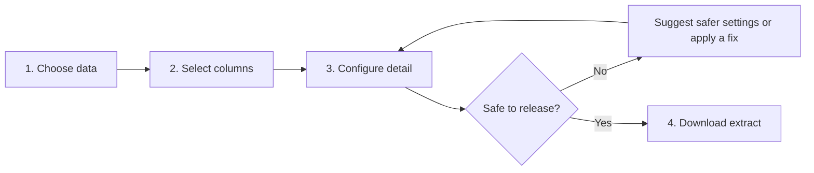

# Medical Data Anonymizer

**Turn a CSV of patient data into a research-ready extract and prove that no one in it can be identified.**

[Highlights](#highlights) · [How it works](#how-it-works) · [Quick start](#quick-start) · [User guide](#user-guide) · [Regulations](#regulations-gdpr-and-hipaa) · [Glossary](#glossary) · [FAQ](#questions-and-problems)

---

## Highlights

| Feature | What it means |
|:---|:---|
| **Data never leaves the device** | The file is read inside the page. It's never uploaded or stored, and it disappears when the tab closes. The page can't make network requests at all, so it can't leak data by mistake. |
| **Formal privacy guarantees** | Checks k-anonymity, l-diversity and t-closeness, plus the average re-identification risk, as you go. |
| **Guided fixes, not just warnings** | Each failing check comes with fixes that show their cost to the researcher. **Suggest safer settings** generalizes columns for you. |
| **Deterministic by design** | Suggest uses fixed rules, with no AI and no randomness. The same file always gets the same result. |
| **Regulation-aware** | Built-in indicators for GDPR anonymisation (singling out, inference, linkability) and HIPAA Safe Harbor. |
| **Try it without real data** | One click loads 500 made-up clinic patients. |

---

## How it works

Someone who already knows a few things about a person (age, sex, town) could look for them in a shared file. If only one row matches, they've found that person and can read everything else in that row.

So the tool sorts every row into **groups**: rows that look the same on the things others could know. A file is safe when:

- **every group is big enough** (at least 5 rows by default), so nobody can be picked out, **and**
- **the private answers vary inside each group**, so knowing someone's group doesn't reveal their answer.

> [!TIP]
> **Example.** A file shares age, sex and city. Only one 87-year-old woman lives in Kiel, so she's a group of one, and anyone who knows her finds her row. Showing age in 10-year ranges (80–89) puts her in a group with other women in their 80s in Kiel, and she can no longer be singled out.

---

## Quick start

1. **Choose your data.** Open a CSV, or click **Use mock data** to try it with 500 made-up patients.
2. **Select columns to share.** Check the type and use of each column. The tool pre-fills a guess.
3. **Configure column details.** Make columns less detailed where needed, for example age in 10-year ranges.
4. **Review and export.** When the verdict says **Safe to release**, click **Download extract (CSV)**.

> [!NOTE]
> Not safe yet? Press **Suggest safer settings**, or open a red item in the safety checklist and use one of its fixes. You can jump between steps at any time. The verdict and checklist update live.

---

## User guide

### Step 1: Choose your data

- **The file.** A CSV with column names in the first row. Commas, semicolons and tabs all work as separators. Excel exports with accented characters (é, ü) are read correctly. Choose the file or drag it onto the box.
- **Empty values.** Blank cells, `NA`, `N/A`, `null`, `none`, `NaN`, `unknown`, `-` and `?` count as empty.
- **Mock data.** 500 made-up clinic patients with names, emails, postcodes, full dates and clinical values.
- **Only include rows where…** *(optional)* keeps just the rows you want, for example *Subtype is Tremor-dominant*. It works on text columns with up to 60 distinct values, and the column doesn't have to be shared.
- **Forget this file** removes it from the page.

### Step 2: Select columns to share

Each column has two settings. The tool fills in a guess and says why, so check every row.

#### Type: what the values are

| Type | Recognised when | What you can do with it |
|:---|:---|:---|
| **Number** | 90% of values are numbers (`26,5` counts) | Share in ranges, limit to a range |
| **Date** | 90% are dates (`2019-05-03`, `03.05.2019`, `03/05/2019`) | Shared as the year only, in ranges |
| **Postcode** | Name contains *zip*, *postcode*, *postal* or *PLZ* | Keep the first 3 or 2 characters |
| **Text / category** | Anything else | Group rare values as "other" |
| **ID / identifier** | Name says ID, record or case number, or every row differs | Usually left out |

If the guess is wrong, change it. The step 3 options follow the type. If the values don't fit the new type (e.g. "Date" on a column of names), the tool says so and nothing changes.

#### How it's used

| Role | Meaning | Used for |
|:---|:---|:---|
| **Others could know it** | A neighbour, employer or social media could know it (age, sex, city, postcode, job) | Forms the groups. Suggest makes these less detailed. |
| **Private (research data)** | Only the person told you (a diagnosis, a test result, an answer) | Must vary inside each group |
| **Leave out** | Names, contact details, anything the research doesn't need | Not exported, not checked |

> [!WARNING]
> Don't mark something **private** if others could know it. The file would look safer than it is.

**Identifiers** (names, emails, phone numbers, addresses, ID numbers) start as *Leave out*. You can still share an ID, e.g. for a recipient allowed to hold pseudonymous data under an agreement, and the checklist then warns that the file is **pseudonymous, not anonymous**. Columns with the same value on every row also start as *Leave out*.

### Step 3: Configure column details

Less detail makes people harder to single out. Each shared column has a card.

| Control | Applies to | What it does |
|:---|:---|:---|
| **Shown value** | Numbers, dates | Range width. `1` = exact, `10` = 60–69, 70–79… Dates are always years. |
| **Who's included** | Numbers, dates | Keep only part of the range (e.g. ages 18–89). Rows outside it or without a value are dropped. |
| **Detail level** | Text, postcodes | Exact, first 3 or 2 postcode characters, or rare values (fewer than *k* rows) as "other" |
| **Leave out people who didn't give this** | Any | Drops rows where this column is empty |
| **Only rows with a value in every private column** | Private columns | Groups made only of empty answers can't vary, so the check would fail |
| **Remove people in groups smaller than k** | Whole file | Drops rare combinations instead of generalizing, capped at 5% of rows by default to avoid biasing the research |

### Step 4: Review and export

Step 4 lists every choice you made, each with a **Change** link back to its step.

**The verdict** stays pinned at the top right: **Safe to release** or **Not safe to release yet**, with the row count, how many rows are one of a kind and how many sit in groups that are too small.

| Action | Description |
|:---|:---|
| **Suggest safer settings** | Generalizes columns for you (see [What Suggest does](#what-suggest-does)) |
| **Preview data** | First 200 rows exactly as exported, available even before the file is safe |
| **Download extract (CSV)** | Enabled only when every required check passes |

### The safety checklist

Four questions. Each is a single line until opened. Red means it needs fixing.

#### 1. Can someone be picked out?

| Check | Passes when |
|:---|:---|
| At least 20 people | The file has at least 20 rows (small files are easy to re-identify) |
| Everyone is in a group of k or more | Smallest group has at least *k* rows (k-anonymity) |
| Nobody is one of a kind | No row has a combination nobody else has |
| Low overall risk | Groups ÷ rows is 10% or less (average re-identification risk) |
| Removed at most 5% | Only when you remove small groups |

Opening it shows **What drives the risk** (how many rows would still be unique with less detail or without each column), the **Rarest combinations**, **Group sizes** and ways to fix it.

#### 2. Can private answers be guessed?

A table covering every private column:

| Measure | Rule | Example |
|:---|:---|:---|
| **Variety** | The fewest distinct answers inside any group. Must be at least 2. | All 6 women aged 70–79 from Germany answered "yes" to "Do you smoke?". Variety is 1, so anyone who knows a neighbour is in that group knows she smokes. One "no", or one empty answer, makes it 2. |
| **Gap** | How far a group's answers are from everyone's, from 0 (same mix) to 1 (completely different). Above 0.35 it's a warning only. | 20% overall said "yes" to chemical exposure, but 90% of "men, 60–79, Germany" did, so the gap is 0.7. Nobody's answer is revealed, but "yes" is very likely. It may be exactly what the research is about, so check whether such a likely answer could harm someone. |

#### 3. Are identifiers left out?

Confirms no ID column is shared, or warns if you chose to share one.

#### 4. Regulations

GDPR and HIPAA indicators. See [Regulations](#regulations-gdpr-and-hipaa).

#### Fixing problems

Each red item has **Ways to fix it**. Every fix shows what it costs the researcher and comes with a button:

- **Make columns less detailed** runs Suggest.
- **Leave out the N people in groups smaller than k** shows the share it needs and raises the limit to exactly that.
- **Remove the column** that causes the most risk, or a private column that gives answers away.

---

## What Suggest does

Suggest follows **fixed rules**, with no AI and no randomness, so the same file always gets the same suggestions.

1. If leaving out the rows in small groups is enough, within your limit, it does that.
2. Otherwise it tries one small step on every column others could know, keeps the step that helps most, then repeats. A step is one of:
   - a wider range: `1 → 2 → 3 → 4 → 5 → 6 → 8 → 10 → 12 → 15 → 20`
   - a shorter postcode
   - rare values as "other"
3. It stops when the file is safe or nothing can be generalized further. Changes that didn't help are undone.

> [!IMPORTANT]
> Suggest **never** removes people beyond your limit and **never** removes a column on its own. Both change what the researcher gets, so they're offered as buttons for you to decide. **Undo these changes** puts everything back.

---

## The exported file

- One row per person, **shuffled**, with a new random `study_id` (`S00001`, `S00002`…) that can't be traced back to the original rows.
- Column order: the columns others could know first, then the private ones, under their original names.
- Values as configured: ranges like `60–69`, years for dates, shortened postcodes like `101…`, `other` for rare values, `(not given)` for empty values.
- Left-out columns and removed rows are not included.
- File name: `<your file>-anonymized-<date>.csv`

---

## Release policy (the gear)

The gear next to the title opens the safety rules every file must meet. A dot on the gear means you've changed a default. **Back to defaults** restores them.

| Setting | Default | Meaning |
|:---|:---:|:---|
| **k**: smallest group | `5` | Each combination of the columns others could know must be shared by at least *k* rows. 5 is common; use 10+ for small or sensitive groups. Also used by "remove groups smaller than k" and "rare values as other". |
| **l**: different answers | `2` | Each group needs at least *l* distinct answers in every private column. 3 is stricter. |
| **t**: max gap | `0.35` | Above this, a group's answers count as noticeably different from everyone's. Warning only. |
| Max average risk | `0.1` | Groups ÷ rows must not exceed 10%. |
| Min people | `20` | Smallest file you may export. |
| Max share removed | `0.05` | Most rows "remove groups smaller than k" may drop (5%). |

---

## Regulations: GDPR and HIPAA

The Regulations item checks the file as it would be exported against two frameworks.

> [!CAUTION]
> This is an indicator, not legal advice. Your data protection officer makes the final call.

### GDPR (EU)

Data is anonymous only if people can't be re-identified *by means reasonably likely to be used*. EU data protection authorities test three risks:

- **Singling out:** nobody can be picked out (the group checks). A shared ID column fails this test.
- **Inference:** private answers can't be deduced from a group (variety and gap).
- **Linkability:** rows can't be joined back to people. Random study IDs and shuffled rows help. Whether the recipient holds other data to join on can't be checked here, so you confirm it.
- **Data minimisation:** only what the research needs. You confirm it.

### HIPAA Safe Harbor (US)

A fixed list of 18 identifier types, relevant only for US healthcare recipients. The tool checks what the data can show:

- no names, contact details or ID numbers
- no location smaller than a state: exact postcodes fail, and 3-digit prefixes are allowed only for areas with more than 20,000 people
- dates as years only
- ages over 89 grouped as 90+: an age or birth year that is entirely 90 or older fails
- no other unique codes

Photos, biometrics, names hidden in free text and "no actual knowledge that the data could identify someone" can't be checked automatically, so they're listed for you to confirm.

---

## Glossary

| Term | Meaning |
|:---|:---|
| **Group** *(equivalence class)* | Rows with the same values in every column others could know |
| **k-anonymity** | Every group has at least *k* rows |
| **l-diversity** | Every group has at least *l* distinct values in each private column |
| **t-closeness** | Each group's answers are within *t* of the whole file's answers |
| **Quasi-identifier** | A column others could know that helps identify someone in combination with others |
| **Generalization** | Showing less detail (ranges, shorter postcodes, "other") |
| **Suppression** | Leaving out rows that are too rare |
| **Pseudonymous vs anonymous** | Pseudonymous data can still be linked to a person (via an ID or a key someone keeps) and stays personal data under GDPR. Anonymous data can't be linked back. |

---

## Questions and problems

**Suggest can't make it safe.**
It names the remaining options. Usually these are leaving out a few more rows (raise the limit), removing the column that drives the risk (often a rare category such as an unusual sex value or a small city), or removing a private column with a rare answer.

**"N values couldn't be read as numbers/dates".**
Those cells count as empty. Check the column's type in step 2, or fix the values in the file.

**My postcode column shows ranges.**
It was recognised as a number. Set its type to *Postcode*.

**Strange characters (`é`).**
The file isn't UTF-8. The tool tries the Windows encoding Excel uses, but saving as "CSV UTF-8" in Excel avoids the problem.

**Large files.**
Everything runs in browser memory. Files up to about 200,000 rows work; beyond that the page gets slow.

**Reloading the page forgets the file.**
By design. The tool only remembers which step you were on.
